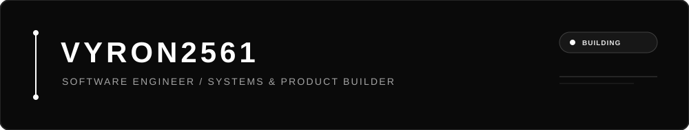

<div align="center">



<br/>


</div>

---

### ⚡ OVERVIEW & FOCUS

> **Core philosophy:** Simplicity is the ultimate sophistication. I’m interested in building reliable software, thoughtful architectures, and minimalist interfaces where performance and clarity come first.

```ini
[PROFILE]
Identity    = VYRON2561
Status      = Building
Focus       = Software Engineering, System Architecture, UI/UX
Principles  = Simplicity, Performance, Precision
Environment = Linux
```

### ◼ CURRENT INTERESTS

- Designing maintainable software and clean architectures
- Building useful web and mobile experiences
- Exploring Linux, automation, and developer tooling
- Improving performance, reliability, and user experience

### ◼ DESIGN LANGUAGE

**MONOCHROME ONLY** · Black backgrounds · White typography · Subtle gray details

---

<div align="center">

<sub>DESIGNED WITH CLARITY. BUILT WITH PURPOSE.</sub>

</div>
